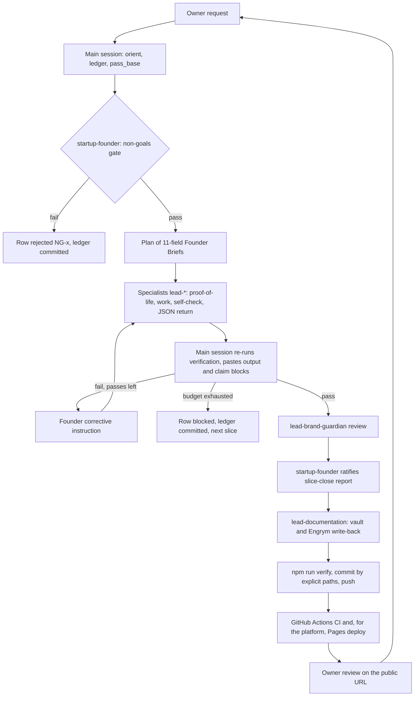
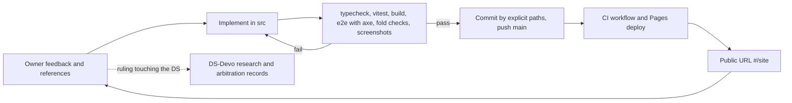

# AI architecture of the build pipeline

This document describes how the Devoteam design system (DS-Devo) and the Atelier platform (this repo) are built by agents, how the work was actually run, and how to hand it over to Engrym so a team or an agent can resume without the original session. Facts are anchored to commits: platform HEAD `8ab049a`, DS-Devo HEAD `ea9b918` (2026-10-30).

## 1. Purpose and north star

- **DS-Devo north star** (`workflow.config.json` > `project.northStar`): a Devoteam design system (tokens, React components, documentation) built and maintained end to end by agents, with no human in the loop. Owner: Bertrand Rocchi.
- **Platform purpose** (README, Claude project "DS Devoteam"): one product chaining company identity, design system, component library, use cases and insights, journey builder and interactive preview; plus a rebuild of devoteam.com made only of reusable patterns, published at https://berocfr.github.io/ds-devo-platform/#/site.

## 2. Two repos and how they relate

| Repo | Path | Role |
| --- | --- | --- |
| DS-Devo, `BerocFr/ds-devo` | `/home/claude/ds-devo` | Source of brand values and (future) tokens and components. Runs the autonomous agentic protocol. |
| Atelier, `BerocFr/ds-devo-platform` | `/home/claude/ds-devo-platform` | Consumer. React 18, TypeScript, Vite, zustand, React Flow. Owner-in-the-loop delivery. |

Rules of the relationship:

- Brand values come only from DS-Devo `brand/README.md` (mirror, with per-section citations, of the Engrym "Devoteam DS" document `brand/devoteam-web-foundations.md`, id `6c66409e`, v2). The platform never redefines them.
- A value the brand does not define is a `todo-brand` token in the platform (`TODO-BRAND` in DS-Devo), never an invented one. Example: the candidate night `#141414` and the mono face were relabelled todo-brand in the platform seed (6fff6bc, DS-Devo D-I2, D-I8).
- Generic components the platform needs are proposed as DS-Devo backlog rows (for example S-026 Stepper, S-027 verification code input, S-030 EmptyState), not frozen in the platform.
- DS-Devo treats the platform as out of scope (D-B18, NG-1 "no application screens"). Platform code informs DS anatomy only (D-S12); platform divergences are logged in DS-Devo arbitrations, not merged.
- State of DS-Devo at HEAD: S-001 (monorepo bootstrap) and S-002 (brand intake) are `done`; S-003 to S-066 are `todo`. There is no `packages/` directory yet, so the platform mirrors tokens by hand in `src/data/seed.ts` until DS-Devo releases `@devoteam/tokens` (S-012).

## 3. Actors

| Actor | Role | Writes only here |
| --- | --- | --- |
| Main session | Runs the lifecycle, dispatches, re-runs verification, commits | DS-Devo `docs/slices/**`; status cells and append-only new rows of `docs/backlog.md` (rows need a founder decision id, OD-3) |
| startup-founder | Router, non-goals gate, plan of Founder Briefs, corrective instructions, autonomous ratifier. Never writes files. When nested spawning is unavailable it works in dispatch-relay: returns a dispatch package, the main session spawns the specialist and relays verified output back with SendMessage | nothing |
| lead-design-tokens | Tokens (color, type, spacing, radius, motion, elevation), light and dark | `packages/tokens/**`, `brand/**` |
| lead-ui-components | React components consuming tokens only | `packages/ui/src/**`, `packages/ui/package.json`, `packages/ui/tsconfig.json` |
| lead-accessibility | WCAG 2.2 AA audits and fixes, axe wiring | `packages/ui/src/**/a11y.*`, `tools/a11y/**` |
| lead-qa | Unit, interaction, visual and a11y suites | `**/*.test.ts(x)`, `e2e/**`, `vitest.config.*`, `playwright.config.*` |
| lead-storybook-docs | Stories and MDX usage docs | `apps/docs/**` except `apps/docs/content/**`, `**/*.stories.tsx`, `**/*.mdx` outside `apps/docs/content/**` |
| lead-ux-writer | Component copy, naming, docs prose | `packages/ui/src/**/copy.ts`, `apps/docs/content/**` |
| lead-devops | Tooling, CI, release, lint configs | `.github/**`, root `package.json`, `tsconfig*.json`, `.changeset/**`, `scripts/release/**`, `.vale.ini`, `.vale/**`, `tools/content-lint/**`, `eslint.config.*`, `stylelint.config.*`, `.stylelintrc*` |
| lead-brand-guardian | Read-only brand compliance review | nothing (returns findings) |
| lead-documentation | Librarian: the only writer of `vault/`, changelog, Engrym write-back | `vault/**`, `CHANGELOG.md` |

Sources: DS-Devo `CLAUDE.md` section 1, `workflow.config.json` > `roster` (machine-readable), `.claude/agents/*.md`. The roster was amended by owner rulings D3, OD-1, OD-2 (bench-01 arbitration). Specialists have no Engrym tools: the main session relays Engrym documents into `docs/slices/<id>/source/` and performs `write_document` calls on their behalf (`docs/slices/HANDOFF.md` section 5).

## 4. Slice lifecycle (DS-Devo)

A slice is one row of `docs/backlog.md` with a ledger `docs/slices/<id>.ledger.md` (from `_template.ledger.md`) and proof-of-life files under `docs/slices/<id>/pol/`. Entry point: the `run-slice` skill.

1. **Orient.** Row to `in-progress`; record `pass_base = git rev-parse HEAD`; create the ledger; Engrym `get_project_brief` and `get_relevant_knowledge` (fail-soft: one direct retry, then log and continue).
2. **Gate and plan.** Dispatch `startup-founder`. It checks `docs/non-goals.md` (NG-1 to NG-7; NG-5 only when more than one package is touched). `gate: fail` closes the slice as `rejected (NG-x)`. Otherwise the plan enters the ledger.
3. **Dispatch and execute.** One specialist per step, brief verbatim; at most two concurrently and only on disjoint globs (`concurrent_with`). Each writes a Step 0 proof-of-life file, works, self-checks (budget, default 3), returns one fenced JSON block (`pass_base`, per-check `result` and `evidence`, channel-scope fields, `criteria_touched`, `controls_touched`).
4. **Verify.** The main session re-runs every `verification-commands` entry and pastes real output into the ledger with a fenced `claim` block (`channel`, `claim`, `nearest_unreachable_claim`). Failures go to the founder for a corrective instruction, then back to the same specialist conversation (SendMessage), up to `autonomy.maxCorrectivePasses` (3). Each pass appends one continuation line to the same proof-of-life file.
5. **Close.** `lead-brand-guardian` reviews user-visible changes; the main session writes the slice-close report mechanically from the ledger; the founder ratifies (requires pasted output for every check; since D17 a green Actions run on the exact SHA; merges to main fast-forward only, D18); `lead-documentation` updates `vault/` and Engrym; `npm run verify`; commit by explicit path `feat(<scope>): <title> [<id>]`; push; row to `done`.

### The 11-field Founder Brief

`slice-id`, `step`, `owner` (one agent), `goal`, `task` (imperative), `files-in-scope` (inside the owner's globs, never `**`), `non-goals` (never empty), `context` (Engrym atoms, ratified first, prior outputs, brand sources), `acceptance-checks` (behavioral, falsifiable; "works", "looks good", "tests pass" are rejected), `verification-commands`, `budget`. A specialist refuses a brief missing any field. Source: `docs/04-brief-contract-and-verification-gates.md`.

### Verification gates (`npm run verify` in DS-Devo)

| Gate | Script | Protects against |
| --- | --- | --- |
| sync:check | `scripts/sync-harnesses.mjs --check` | drift between `CLAUDE.md` and generated `AGENTS.md`, `GEMINI.md`, `.cursor/rules` |
| pol:templates | `tools/ci/check-agent-pol-template.mjs` | broken Step 0 templates, stale Codex mirrors |
| pol:frontmatter | `tools/ci/check-proof-of-life-frontmatter.mjs` | proof-of-life files that lose the task |
| guardrails | `tools/ci/agent-guardrail-preservation.mjs --mutate` | an agent losing a guardrail (mutation-tested) |
| channel-scope | `tools/ci/check-channel-scope-fields.mjs` | ledger claims broader than measured |
| pol:selftest | `tools/ci/selftest.mjs` | gates accepting bad input |

`npm run ci` adds typecheck, test and build.

### Autonomy and autopilot

- No human in the loop: the founder resolves ambiguity with the most conservative reading of the non-goals and north star and logs a decision.
- Budget exhausted: row to `blocked: <reason>`, commit the ledger, move on (`onBudgetExhausted: mark-blocked-and-continue`).
- `npm run autopilot` (`scripts/autopilot.mjs`, options `--harness claude|codex|antigravity`, `--max N`, `--dry-run`) runs one fresh harness session per slice, up to `maxSlicesPerRun` (5), picking the first `todo` row whose dependencies are `done`. The `autopilot` skill describes the same loop in-session. Note: `CLAUDE.md` refers to `docs/07-autopilot.md`, which does not exist; the script and the skill are the reference.
- Engrym writes are proposals a person may ratify later; they never block the pipeline.



## 5. Owner-in-the-loop design rounds

The visual direction was not decided autonomously. The owner fed references and ruled; the founder arbitrated in DS-Devo; the platform applied the rulings. Records live in DS-Devo `docs/slices/research/`:

| Round | Research | Arbitration and outputs |
| --- | --- | --- |
| bench-01 | `awwwards-agencies.md`, `webflow-components.md`, `ds-content-motion.md` | `bench-01/arbitration.md`: D-B*, owner rulings D3, OD-1, OD-2, OD-3 (main session may append backlog rows with a decision id), OD-8 (platform as a separate codebase), rows S-013 to S-037 |
| site-bench-02 | `devoteam-site-analysis.md`, `bench-02-site-gaps.md` | `site-bench-02/arbitration.md`: D-S*, rows S-038 to S-052, open OD-S1 to OD-S5 |
| bench-03 | `bench-03-motion-agencies.md` | `bench-03/arbitration.md`: D-M* (stock imagery D-M1, Lucide icons D-M2, motion values derived D-M5, no marquee on corporate pages D-M9), rows S-053 to S-062 |
| bench-04 | `bench-04-identity-agencies.md` | `bench-04/arbitration.md`: D-I1 to D-I8 ("AI leader, same DNA" accepted as expression, night surface derived, no mono token, lattice not admitted), rows S-063 to S-066, open OD-I1 to OD-I3 |
| bench-05 | `bench-05-rowalo-reference.md` | No new row; records how the platform applied the Rowalo reference and the second owner round (generated fluted hero visuals, red primary, burger menu) |

Binding owner brand decisions (2026-10-29, Engrym `6c66409e` v2, `HANDOFF.md` section 6): keep `#f8485e` and add a `primary-strong` token carrying white text at 4.5:1 or more (estimate `#ea0925`, final in S-003); the dark theme is derived and labelled `derived`; Montserrat is self-hosted via `@fontsource-variable/montserrat`.

### How the platform work was run

The platform does not run the founder and specialist roster. It runs a direct loop in one session, under its own `CLAUDE.md`:

1. Owner feedback (screenshots, references, verbatim requests) in the Claude project "DS Devoteam".
2. Implementation in `src/` (domain logic pure in `src/domain`, persistence only through `PlatformRepository`).
3. Local verification: `npm run typecheck`, `npm test` (Vitest, jsdom), `npm run build`, `npm run e2e`. `e2e/smoke.mjs` serves the build with `vite preview`, drives headless Chromium (`playwright-core` with `@sparticuz/chromium`), fails on console errors, runs axe (WCAG 2.0 to 2.2 A and AA tags) on every section and site page and at phone width, checks hero elements above the fold at 1440x900, 1280x720 and 1000x600, keyboard and focus return on menus, and saves screenshots to `e2e/shots/` (evidence, not assertions).
4. Commit by explicit paths, with the attribution trailer.
5. Push to `main`: `.github/workflows/ci.yml` (npm ci, typecheck, test, build, e2e on Node 22) and `.github/workflows/pages.yml` (build, publish `dist/` to GitHub Pages).
6. Owner review on the public URL, then the next round. When a ruling touches the design system, the DS-Devo main session records it as research or arbitration (for example 6fff6bc aligned the platform seed with D-I2 and D-I8).



## 6. Platform artifacts and data model (handoff)

| Artifact | Path | Notes |
| --- | --- | --- |
| Pattern renderer | `src/ds/SitePatterns.tsx` | `renderSitePattern(def, inst, ctx)` switches on `def.kind`. 20 site pattern kinds: `pSiteHeader`, `pSiteFooter`, `pHeroMedia` (variant `lattice` kept pending OD-I2), `pPageHero`, `pImpactIntro`, `pIntroStatement`, `pStatsBand`, `pExpertiseGrid`, `pFeatureDuo`, `pFeatureRows`, `pSpotlightBand`, `pStorySplit`, `pCaseTeaser`, `pChallenges`, `pPartnerShowcase`, `pLogoBand`, `pSignposts`, `pClosingStatement`, `pExpertTeam`, `pOfficeDirectory`. `SiteCtx.mode` is `thumb`, `preview` or `interactive`; `tone` prop accepts `night`, `paper`, `mist`, `evidence`. Styles in `src/ds/site-patterns.css`. |
| Pattern catalog | `src/data/siteCatalog.ts` | `siteAtoms`, `sitePatterns`, `rebuildPatterns` (`ComponentDef` with `composedOf`, props, provenance note). |
| Other catalogs | `src/data/benchCatalog.ts`, `src/data/siteUseCases.ts` | Benchmark components; devoteam.com use cases and insights. |
| Site pages | `src/data/devoteamSite.ts` | `SITE_PAGES` (home, cybersecurity, cloud native, join us, offices, success stories, services, contact, AI maturity, jobs, topic pages), each a list of `SiteSection { componentId, variantId, props }` plus `changes` (UI pass notes). `siteLink(key)` resolves a link key: absolute URL, `home`, `about-prototype`, a page id, or a label that slugs to a page id. `toInstances(page)` turns sections into `ComponentInstance`s. Rendered by `src/features/site/SiteApp.tsx`. |
| Prop encoding | `src/ds/SitePatterns.tsx` (`rows`, `list`) | List props are strings: rows separated by `;`, fields within a row by `\|`, simple lists by `,`. Footer groups use `\|\|` between groups and `label>key` links. `src/data/site.test.ts` checks that every link key resolves. |
| Seed workspace | `src/data/seed.ts` | `createSeed()` returns tokens, components, use cases, insights, journeys; `catalogVersion: 3`. |
| Store and persistence | `src/store/store.ts`, `src/store/repository.ts` | zustand store with per-journey undo. `mergeSeed(saved, seed)`: when the saved `catalogVersion` is lower than the seed's, appends new tokens, components, use cases and insights by key, never overwrites. Bump `catalogVersion` whenever the catalog grows. |
| Domain | `src/domain/` | `types.ts` (`ComponentKind`, `ComponentDef`, `ComponentInstance`, `JourneyNode`, `PlatformData`), `tokens.ts`, `validation.ts`, `generator.ts`, `nlPlanner.ts`, `claudePlanner.ts`. |
| Hero visuals | `tools/make-hero-visuals.py` | Procedural coral fluted-glass images from brand coral stops (numpy, Pillow, scipy); writes `src/assets/heroes/fluted-1..6(.jpg, -sm.jpg)`; mapped in `src/data/heroVisuals.ts`. |
| Photos | `src/data/photos.json`, `src/data/photos.ts` | 37 Pexels photos with alt text, loaded from the Pexels CDN at view time (prototype choice, D-M1 notes a consumer site would self-host). |
| e2e | `e2e/smoke.mjs` | See section 5. |

Three levels of a component stay distinct: `ComponentDef` (design in the library), `ComponentInstance` (one use in a screen), `JourneyNode` (role in the journey).

## 7. Engrym integration

Always pass `projectId: "9674c217-7e1d-43ce-b624-9d69b0e9e151"` (Devoteam DS); the connected default project is a different one. Endpoint `https://engrym-mcp-remote.fly.dev/mcp`. Contract: DS-Devo `ENGRYM.md`.

| Pipeline step | Engrym calls |
| --- | --- |
| Session start | `get_project_brief` (or `get_init_brief` on first run) |
| Orient on an area | `get_relevant_knowledge` with `scope` / `scopeHint` = active glob (for example `packages/ui/**`, `src/ds/**`); `get_active_intents` |
| Gate and plan | `query_brain` (categories `constraint`, `decision`), `find_contradictions` |
| Before editing | `broadcast_intent` on the files (24 h lease), `check_conflicts` if another agent may be active |
| After editing | `release_intent` |
| Durable knowledge (a why, examples, several sentences) | `write_document` (markdown, path under `docs/` or `vault/`) |
| Bare self-contained facts | `log_decision`, `add_brain_entry` |
| Close | `write_document`, `log_decision`, `link_atoms` (inspect per-item results), `save_session_state` |
| Outage claim | prove it first with a direct `list_projects` or `get_project_brief` |

Weighting: `ratified: true` atoms rank highest; never rank by `confidence`. An unratified atom that work contradicts is recorded as a disagreement in the ledger, not silently overridden. Every write is a proposal; retry once, then log the unpersisted write. Extraction (`pull_extraction_work`, `submit_extraction`) only with the project's `autoPull.consent`.

Already in Engrym (HANDOFF section 5, proposals, none ratified at that time): `brand/devoteam-web-foundations.md` (`6c66409e`, v2), `vault/slices/S-001-monorepo-bootstrap.md` (`a522a4d9`), `vault/slices/S-002-brand-intake.md` (`04fd8ed8`).

### Write back first (in this order)

| Knowledge | Engrym form | Source documents |
| --- | --- | --- |
| Brand references and owner brand decisions | already a document; derive atoms, cite atom ids in `brand/README.md` (S2-D11) | DS-Devo `brand/README.md`, `docs/slices/HANDOFF.md` section 6 |
| Bench arbitrations (decisions D-B, D-S, D-M, D-I) | one `write_document` per arbitration, one `log_decision` per decision id | DS-Devo `docs/slices/research/bench-01/arbitration.md`, `site-bench-02/arbitration.md`, `bench-03/arbitration.md`, `bench-04/arbitration.md`, `bench-05-rowalo-reference.md` |
| Owner decisions OD-* (accepted and open) | `log_decision` for each ruled one; a document listing open ones | arbitrations above, `docs/slices/HANDOFF.md` |
| Pattern catalog (kinds, props, encoding, composedOf, provenance) | `write_document` scoped `src/ds/**`, `src/data/**` | this file section 6, `src/data/siteCatalog.ts`, `src/ds/SitePatterns.tsx`, platform `README.md` |
| Verification gates and brief contract | `write_document` | DS-Devo `docs/04-brief-contract-and-verification-gates.md`, `docs/non-goals.md`, platform `CLAUDE.md`, `e2e/smoke.mjs` |
| Platform history | `write_document` | this repo `CHANGELOG.md` |

### Open owner decisions (from DS-Devo docs at `ea9b918`)

- **OD-4** Brand voice documentation into Engrym (tone of voice is TODO-BRAND).
- **OD-6** Confirm US English, serial comma, point médian ban (pending confirmation).
- **OD-7** Optional rewording of non-negotiable 2 to match D-B2.
- **OD-S1** Status palette: official values or derived values labelled derived.
- **OD-S4** Priorities: bench-02 rated event card, job card, filters and file upload P0; the founder set P1.
- **OD-S5** Consent banner legal copy and categories (legal owner).
- **OD-I1** Mono typeface for data labels (default: Montserrat 500 uppercase, D-I6).
- **OD-I2** AI motif (signal lattice); default stock imagery only.
- **OD-I3** Confirm the inverse section tone moves to the derived night surface (default applied per D-I3, reversible).
- To log: the bench-05 owner ruling on generated hero visuals, to be recorded against D-S7 and D-I7 when a visual asset row opens.

Ruled: OD-1, OD-2, OD-3, OD-8 (bench-01), OD-S2 (stock imagery), OD-S3 (Lucide), OD-5 (motion values derived from bench-03, D-M5).

## 8. How to resume

Commands:

```bash
# Platform
cd /home/claude/ds-devo-platform
npm ci
npm run typecheck && npm test && npm run build && npm run e2e
npm run dev                       # http://localhost:5173, site at #/site
python3 tools/make-hero-visuals.py  # only to regenerate hero images

# DS-Devo
cd /home/claude/ds-devo
npm ci
npm run sync && npm run verify    # after editing CLAUDE.md or .claude/agents/*.md
npm run ci                        # verify, typecheck, test, build
```

Node 22.12 or later in both repos.

Checklist:

- [ ] Engrym: `get_project_brief` with the Devoteam DS `projectId`; if it fails, retry once, then prove with `list_projects` before calling it an outage. A new Claude account needs its own Engrym connector and team membership.
- [ ] Read DS-Devo `docs/slices/HANDOFF.md`, `docs/backlog.md` (next `todo` is S-003 tokens), and the latest arbitration.
- [ ] Read this repo's `CHANGELOG.md` (Unreleased line) and `CLAUDE.md`.
- [ ] DS-Devo slices: use the `run-slice` skill or `npm run autopilot`.
- [ ] Platform rounds: owner feedback, implement, run the four checks, commit by path, push, check CI and Pages, ask for owner review on the URL.

Where state lives:

| State | Location |
| --- | --- |
| DS backlog and status | DS-Devo `docs/backlog.md` |
| Slice evidence | DS-Devo `docs/slices/<id>.ledger.md`, `docs/slices/<id>/plan.json`, `docs/slices/<id>/pol/` |
| Design research and rulings | DS-Devo `docs/slices/research/` |
| Durable notes | DS-Devo `vault/slices/` (lead-documentation only) and Engrym |
| Brand values | DS-Devo `brand/README.md`, Engrym `6c66409e` |
| Orchestration config | DS-Devo `workflow.config.json`, `CLAUDE.md`, `.claude/agents/`, `.claude/skills/` |
| Platform catalog and content | `src/data/` |
| Platform user workspace | browser localStorage via `PlatformRepository` (export and import JSON in Settings) |
| Platform history | `CHANGELOG.md`, `git log` |

Standing rules:

- Stage by explicit path only; never `git add -A`, `git add .` or `git commit -a`. No force push; DS-Devo merges to main fast-forward only after ratification.
- No em dashes in shipped copy; sentence case; verbs on buttons; errors say how to fix.
- WCAG 2.2 AA: visible focus, keyboard reachability, accessible names containing the visible label, 4.5:1 text contrast, reduced motion respected; e2e fails on serious or critical axe violations.
- Brand values are never invented: missing values are `todo-brand` (platform) or `TODO-BRAND` (DS-Devo).
- Never weaken, skip or delete a test or a CI gate to make a check pass (NG-7).
- Never edit generated harness files (`AGENTS.md`, `GEMINI.md`, `.cursor/rules/*.mdc`); edit `CLAUDE.md` or `.claude/agents/*.md`, then `npm run sync && npm run verify`.
- Only `lead-documentation` edits DS-Devo `vault/`; agents write only inside their globs.
- Do not bypass the devoteam.com anti-bot protection; brand values come from a normal browser reading or an official charter.
